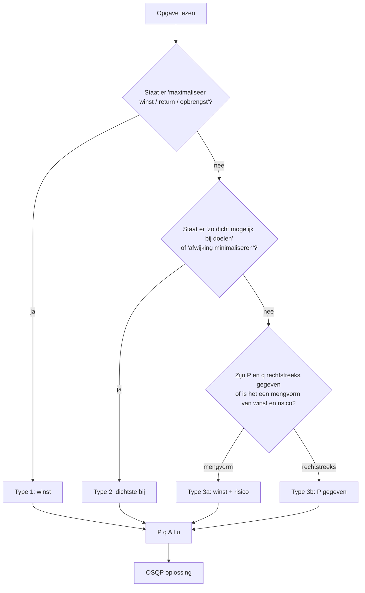

# Stappenplan OSQP

Elke OSQP-opgave los je op met dezelfde route:

> **Keuze variabelen → type herkennen → P en q uit het recept → A, l en u uit de voorwaarden → OSQP draaien.**

OSQP minimaliseert steeds dezelfde vorm:

```
Minimaliseer:  ½ xᵀ P x + qᵀ x
met:           l ≤ A x ≤ u
```

Al het werk zit in het opstellen van de matrices P, q, A, l en u.

---

## Type 1: winst

Waar het om draait:

| ingredient | waarde |
|---|---|
| vraag | maximaliseer winst, opbrengst of verwachte return |
| kost | `min −winst(x)` |
| P | nul-matrix |
| q | `−winst` (teken omdraaien van maximaliseren naar minimaliseren) |
| valkuil | het teken van maximaliseren → minimaliseren vergeten |

Voorbeeld uit het labo, de fabriek:

| product | X | Y | winst |
|---|---|---|---|
| AquaSparkle (a) | 2 | 1 | €5 |
| BioBurst (b) | 1 | 3 | €8 |

Voorraad 100 X en 90 Y:

```
q  = [-5, -8]          # winst negatief, P = 0
A  = [[2,1],           # grondstof X
      [1,3],           # grondstof Y
      [1,0],[0,1]]     # a, b >= 0
l  = [-inf, -inf, 0, 0]
u  = [100,   90,   inf, inf]
```

Oplossing: a = 42, b = 16, winst = €338.

---

## Type 2: zo dicht mogelijk bij een doel

Waar het om draait:

| ingredient | waarde |
|---|---|
| vraag | afwijking ten opzichte van een doelvector `b` zo klein mogelijk |
| kost | `min ‖A x − b‖²` |
| P | `2 · AᵀA` |
| q | `−2 · Aᵀb` |
| valkuil | de factor 2 vergeten (die volgt uit de ½ in de algemene vorm) |

Uitgewerkte afleiding:

```
‖A x − b‖² = xᵀ AᵀA x − 2 bᵀA x + bᵀb
```
De constante `bᵀb` verandert het optimum niet. De algemene vorm gebruikt ½, dus:

```
P = 2 · AᵀA        en        q = −2 · Aᵀb
```

Wil je elke macro/zoveel zwaar laten meetellen, zet je gewichten in een diagonaalmatrix
`W`:

```
P = 2 · Aᵀ W A     en        q = −2 · Aᵀ W b
```

Voorbeeld uit het labo, de macronutriënten. De nutriëntmatrix `N` (één rij per macro,
één kolom per ingrediënt) en de doelen `t = [37, 41, 20]`:

```
min ‖N x − t‖²   →   P = 2 · NᵀN    q = −2 · Nᵀt
```

Daarbovenop komen de randvoorwaarden: x ≥ 0, een som-rij `x_B + x_K + x_A = 7`
(rij van enen met l = u = 7) en per ingrediënt een onder- en bovengrens.

---

## Type 3: andere kosten

Hier valt wat niet in type 1 of 2 past. Twee gevallen:

### 3a. Mengvorm (winst + risico)

De kost is een combinatie van een lineaire en een kwadratische term.

| ingredient | waarde |
|---|---|
| vraag | maximaliseer return maar bestraf risico, met risico-aversie `α` |
| kost | `min ( α · xᵀΣx − return(x) )` |
| P | `2 · α · Σ` |
| q | `−return` |
| valkuil | de juiste plaats van `α` en het min-teken voor de return |

Voorbeeld uit het labo, de portefeuille:

```
P = 2 · α · Σ            # risico, vermenigvuldigd met risico-aversie
q = −r                   # verwachte return, negatief
```

met als randvoorwaarden `som(w) = 1` (rij van enen met l = u = 1) en
`0 ≤ wᵢ ≤ 1` (eenheidsmatrix met l = 0 en u = 1).

### 3b. P is rechtstreeks gegeven

Soms staan P en q gewoon in de opgave en hoef je niets af te leiden. Vul ze dan
onaangepast in en besteed al je tijd aan de randvoorwaarden.

Voorbeeld uit het labo, oefening 1:

```
P = [[4,1],[1,2]]     q = [1,1]      A = [[1,1],[-1,2],[2,1]]
l = [1,0,2]                           u = [2,2,3]
```

---

## Kies het juiste type



---

## Universeel stappenplan

1. **Kies variabelen.** Wat wil je weten? Elke variabele wordt één kolom van `x`.
   Geef ze namen, bv. `a`, `b`, `w_B`.
2. **Herken het type.** Gebruik het stappenplan hierboven om te kiezen tussen
   type 1, 2, 3a of 3b.
3. **Zet de kostfunctie om naar P en q.** Volg het recept van jouw type.
4. **Zet elke randvoorwaarde om naar een rij van A met `l` en `u`:**
   - een `=` splits je in een `≤` en een `≥`;
   - zonder grens gebruik je `±inf`;
   - niet-negativiteit druk je uit met een eenheidsmatrix;
   - `x ≥ 0` wordt `0 ≤ x ≤ inf`.
5. **Controleer en los op.** `#kolommen van A` = `#variabelen`,
   `#rijen van A` = `#voorwaarden`. Draai dan OSQP en interpreteer je oplossing.

---

## Herbruikbare OSQP-snippet

```python
import numpy as np
import osqp
from scipy.sparse import csc_matrix

def solve(P, q, A, l, u):
    prob = osqp.OSQP()
    prob.setup(csc_matrix(P), q, csc_matrix(A), l, u, verbose=False)
    result = prob.solve()
    return result.x
```

Opgelet: P en A geef je als sparse matrix door (`csc_matrix`), en `l`/`u` vul je
rij per rij van `A` in dezelfde volgorde.
