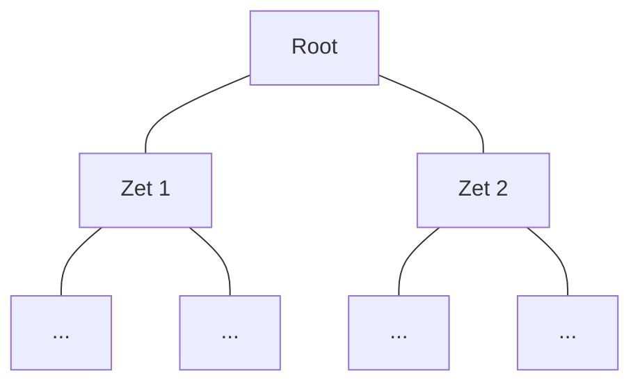
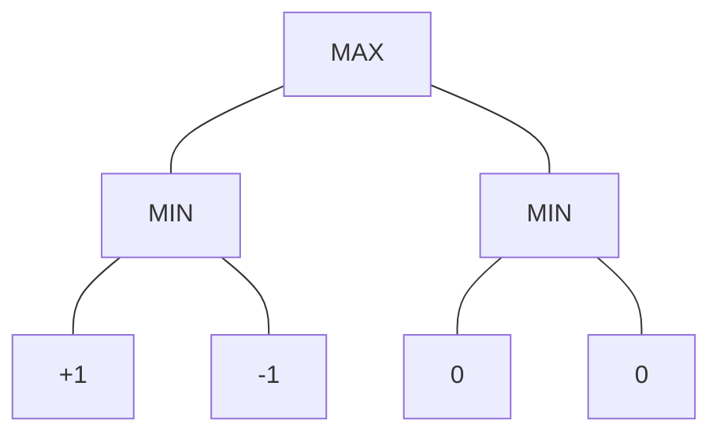
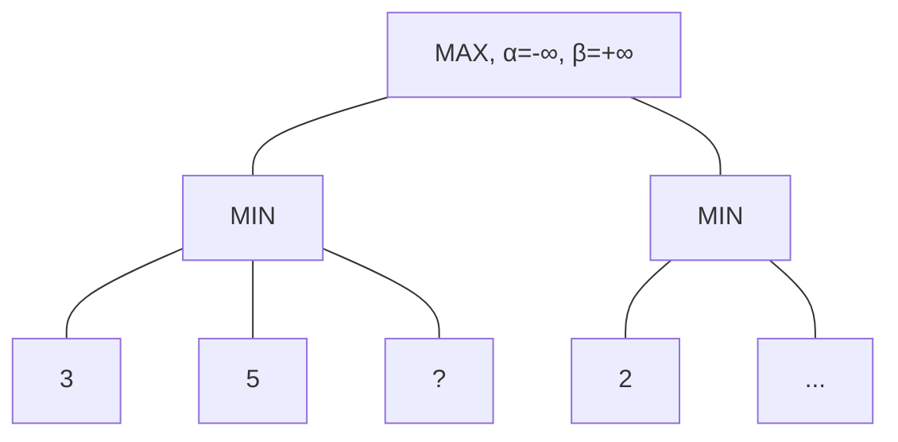
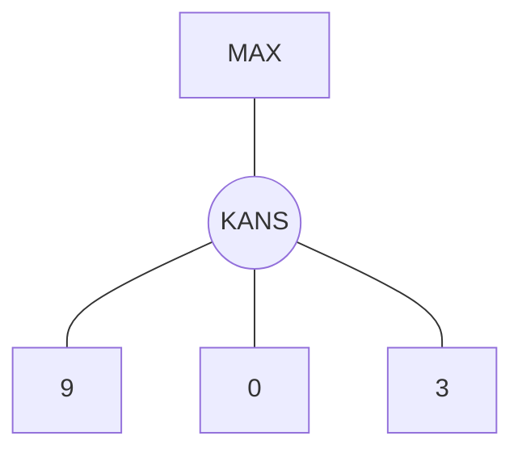

<!-- _class: title-slide -->

# Adversarial search

## Minimax

---

<!-- _class: red-bg -->

# Multi-agent systemen

---

## Multi-agent systemen

- Spellen zoals poker, schaken, dammen, ...
- **Soorten spellen**:
  - Perfect / imperfect information
  - **Zero-sum**: er is 1 winnaar, de rest verliest
     - Een spel is zero-sum als de som van de utilities van alle spelers bij élke afloop **constant** is (meestal 0). Wat de ene speler wint, verliest de ander: winst van de ene = verlies van de andere
     - Voor 2 spelers (we noemen die spelers Max en Min): `utility(Max) + utility(Min) = 0`, bv. +1 en -1. Daardoor kan Min de utility van Max **tegengesteld** gebruiken: geen aparte strategie nodig
- We bekijken **zero-sum, 2-player, perfect information games**


---

## Two-player zero-sum games

Een spel is gekenmerkt door:

- Een **initiële state**
- **Wie aan beurt** is
- De **mogelijke acties** per state
- Een **transitiemodel** als resultaat van acties
- Een **terminal test**: checkt of het spel klaar is
- Een **utility functie**: winnaar +1, verliezer 0, draw ½

> Gelijkaardig aan de state space, alleen zijn er nu 2 spelers die afwisselend iets doen. Je hebt het gedrag van de tegenspeler niet onder controle. We gaan er wel vanuit dat de speler "perfect" kan spelen

---

## De game tree

- De game tree bevat alle mogelijke zetten
- Voor elke move de volgende legale moves
- Wordt al snel **erg groot**



---

### Voorbeeld: game tree voor schaken (beperkt !!!)


---

<!-- _class: red-bg -->

# Minimax

---

## Twee spelers, twee strategieën

| Speler | Doel |
|---|---|
| **Max** (speler 1) | Maximaliseren: wil een terminale staat met utility +1 |
| **Min** (speler 2) | Minimaliseren: wil naar een minimale utility streven (-1) |

- Max wil in een niet-terminale staat juist die actie kiezen die leidt naar een staat met **maximale utility**
- Dat betekent: **achterwaarts redeneren** vanuit de terminale staten

---

## Minimax algoritme

Het algoritme werkt recursief:

- Op een **Max-knoop**: kies de actie met de **hoogste** utility
- Op een **Min-knoop**: kies de actie met de **laagste** utility



---

## Minimax: implementatie

```python
def minimax(board, is_maximizing):
    # Terminal test
    if is_win(board, 'X'):
        return 1  # Max wint
    if is_win(board, 'O'):
        return -1  # Min wint
    if is_draw(board):
        return 0

    if is_maximizing:
        best = -float('inf')
        for zet in possible_moves(board):
            nieuwe_board = board.copy()
            nieuwe_board[zet] = 'X'
            best = max(best, minimax(nieuwe_board, False))
        return best
    else:
        best = float('inf')
        for zet in possible_moves(board):
            nieuwe_board = board.copy()
            nieuwe_board[zet] = 'O'
            best = min(best, minimax(nieuwe_board, True))
        return best
```

- [DEMO]: minimax op tic tac toe

---

<!-- _class: red-bg -->

# Minimax op tic tac toe

---

## Tic tac toe: het bord

- 9 vakjes
- **Max (X)** begint, **Min (O)** reageert
- Terminal test: 3 op een rij of bord vol
- Utility: X wint **+1**, O wint **−1**, bord vol zonder winnaar **0**

---


---

## De game tree: 3 levels diep

- Level 0: het lege bord, **Max (X)** kiest
- Level 1: **Min (O)** reageert
- Level 2: weer **Max (X)**, ...
- Symmetrisch equivalente borden zijn weggelaten, anders wordt de tree meteen te groot

---


---


---


---

## Minimax stap voor stap: achterwaarts redeneren

1. Recurseer eerst **volledig naar beneden**, tot terminale staten
2. Elke terminale staat geeft een **utility**: +1, 0 of −1
3. Op een **Min-knoop**: neem het **minimum** van de kinderwaarden
4. Op een **Max-knoop**: neem het **maximum** van de kinderwaarden
5. De waarde in de node/root = de waarde van het spel bij perfect spel


---

## Minimax op heel tic tac toe

- De volledige game tree van tic tac toe is berekenbaar:
  - 9! = 362.880 mogelijke zetreeksen, maar een spel stopt vaak vroeger: **± 255.000 geldige spelverlopen**
  - Slechts **5.478 verschillende geldige bordposities** (met symmetrie nog minder)
- Resultaat van minimax op het lege bord:


> Bij **perfect spel van beide kanten** eindigt tic tac toe altijd in een **draw**: geen enkele openingszet geeft Max een garantie op winst. Min kan immers altijd de beste reactie vinden

---

## Minimax: beperkingen

- Werkt voor **perfect information games** met een **beperkte** game tree
- Bij grotere problemen wordt het doorzoeken van heel de tree een probleem

| Spel | Branching factor | Depth |
|---|---|---|
| Tic tac toe | ± 4.5 | 9 |
| Schaken | ± 35 | ± 80 |

> Om de grootte van een tree aan te duiden: de **branching factor** (gemiddeld aantal opties per node) en de **depth** (diepte van de boom)

---

<!-- _class: red-bg -->

# Depth-limited search

---

## Wat als de game tree te groot is?

Drie variaties op minimax die hier een oplossing kunnen bieden:

1. **Limited depth**: stop na maximaal N levels
2. **Alpha-beta pruning**: snoei delen van de tree weg
3. **Evaluatiefunctie**: schat de bordwaarde in plaats van de exacte uitkomst

---

## Limited depth en de evaluatiefunctie

- Na maximaal N levels heb je mogelijk **géén terminale staat**
- Maar je wil daar toch een waarde teruggeven
- Gebruik een **evaluatiefunctie** die voor élke bordpositie een schatting geeft

```python
def minimax(board, depth, is_maximizing):
    if depth == 0 or is_terminal(board):
        return evaluate(board)
    # ... recursie met depth - 1
```

> Implementatietip: gebruik een **aftellende** depth in plaats van een optellende

---

## Evaluatiefunctie voor schaken

```python
def evaluate(board):
    score = 0
    # Materiaal: pion=1, paard=3, loper=3, toren=5, dame=9
    for piece in board.white_pieces:
        score += piece_value[piece.type]
    for piece in board.black_pieces:
        score -= piece_value[piece.type]
    return score
```

- De evaluatiefunctie is een **utility functie**: hoe hoger, hoe beter voor Max
- Trade-off:
  - Moet een **goede waarde** geven van een spelbord
  - Mag **niet te lang** duren om te berekenen

---

<!-- _class: red-bg -->

# Alpha-beta pruning

---

## Alpha-beta pruning: het idee

- Minimax berekent **alle** knopen, ook die het resultaat nooit kunnen beïnvloeden
- Ideaal: houd de minimax-waarde **exact**, maar sla delen van de tree over
- Twee waardes die tijdens de recursie worden doorgegeven:
  - **alpha**: de beste waarde die Max tot nu toe kan garanderen (initieel −∞)
  - **beta**: de beste waarde die Min tot nu toe kan garanderen (initieel +∞)
- Als **beta ≤ alpha**: deze tak kan het eindresultaat niet meer verbeteren → **prune** (niet verder aflopen)

---

## Alpha-beta pruning: waarom mag je snoeien?



- Min-knoop A geeft minstens 3 terug → Max garandeert al **α ≥ 3**
- Min-knoop B begint met 2 → het resultaat is **hoogstens 2**
- Max kiest toch al 3, dus de rest van B is **irrelevant**: snoeien!

---

## Alpha-beta pruning: implementatie

```python
def minimax(board, depth, is_maximizing, alpha, beta):
    if depth == 0 or is_terminal(board):
        return evaluate(board)

    if is_maximizing:
        best = -float('inf')
        for zet in possible_moves(board):
            new_board = board.copy()
            new_board[zet] = 'X'
            best = max(best, minimax(new_board, depth - 1, False, alpha, beta))
            alpha = max(alpha, best)
            if beta <= alpha:
                break  # pruning
        return best
    else:
        best = float('inf')
        for zet in possible_moves(board):
            new_board = board.copy()
            new_board[zet] = 'O'
            best = min(best, minimax(new_board, depth - 1, True, alpha, beta))
            beta = min(beta, best)
            if beta <= alpha:
                break  # pruning
        return best
```

- [DEMO]: minimax met alpha-beta op tic tac toe, aantal bezochte knopen vergelijken

---

## Alpha-beta vs depth-limited search

| | **Depth-limited** | **Alpha-beta pruning** |
|---|---|---|
| Doel | Tree **kleiner maken** door vroeger te stoppen | Tree **sneller doorlopen** met dezelfde diepte |
| Resultaat | **Benadering** via evaluatiefunctie | **Exacte** minimax-waarde |
| Kwaliteit | Hangt af van de evaluatiefunctie | Geen kwaliteitsverlies |
| Combinatie | Stopping-criterion | Versterkt elkaar: eerst snoeien, dan dieper zoeken |

> Alpha-beta vervangt depth-limited search niet, ze vullen elkaar aan: met pruning kun je binnen dezelfde tijd **dieper** zoeken

---

<!-- _class: red-bg -->

# Stochastische spellen

## Expectimax

---

## Minimax gaat uit van een perfecte tegenstrever

- Minimax veronderstelt dat de **tegenspeler perfect** speelt en redeneert daarom **pessimistisch** (Min minimaliseert)
- Dat is niet altijd realistisch:
  - **Menselijke fouten**: de tegenstrever speelt niet altijd optimaal
  - **Kanscomponenten**: dobbelstenen, kaarten trekken, een random startpositie
- In *stochastische spellen* (bv. backgammon, 21'en, poker) is het dan niet slim om altijd pessimistisch te redeneren
- Door kansen op te nemen in de game tree bekomen we **expectimax**

---

## Kansknopen in de game tree

- Naast **Max**-knopen (keuze) en **Min**-knopen (tegenspeler) zijn er nu **kansknopen**
- Vanuit een kansknoop bepaalt **het toeval** naar welke volgende staat het spel gaat
- Voorbeelden van kansprocessen:
  - Dobbelsteen gooien
  - Kaart trekken
  - Random initialisatie bij een computerspel
  - Imperfect information: geen zicht op de staat van de tegenspeler (poker, solitaire)



---

## Expectimax: het idee

- Expectimax is hetzelfde als minimax, behalve op **kansknopen**
- Op een **Max-knoop**: het **maximum** van de kinderwaarden
- Op een **Min-knoop**: het **minimum** van de kinderwaarden
- Op een **kansknoop**: de **verwachte waarde** van de kinderwaarden, op basis van de **kansverdeling**
- Verwachte waarde = som over elke uitkomst van (kans × waarde)

```
3 uitkomsten die elk 1/3 kans hebben:
expected = 9 * 1/3 + 0 * 1/3 + 3 * 1/3 = 4
```

---

## Expectimax: implementatie

```python
def expectimax(board, depth, is_maximizing):
    # Terminal test
    if depth == 0 or is_terminal(board):
        return evaluate(board)

    if is_maximizing:
        best = -float('inf')
        for zet in possible_moves(board):
            nieuwe_board = board.copy()
            nieuwe_board[zet] = 'X'
            best = max(best, expectimax(nieuwe_board, depth - 1, False))
        return best
    else:
        # Kansknoop: de verwachte waarde over de uitkomsten
        expected = 0
        for uitkomst in possible_outcomes(board):
            kans = probability(uitkomst)
            expected += kans * expectimax(uitkomst, depth - 1, True)
        return expected
```

---

## Minimax vs expectimax

| Aspect | **Minimax** | **Expectimax** |
|---|---|---|
| Tegenstrever | **Perfect** | Mogelijk **feilbaar** |
| Type spellen | Zero-sum, perfect info | Stochastic, imperfect info |
| Evaluatie | Statische functie | Daarnaast een **kansverdeling** nodig |
| Redenering | Pessimistisch | Op basis van de **verwachte waarde** |

> Minimax vervangt expectimax niet, ze passen bij een ander type spel: met een kanscomponent neem je op de kansknopen de verwachte waarde

---

## Samenvatting

- Spellen: zero-sum, 2-player, perfect information
- Een spel: initiële state, beurt, acties, transitiemodel, terminal test, utility functie
- Minimax: Max maximaliseert, Min minimaliseert, achterwaarts redeneren
- Werkt enkel voor beperkte game trees
- Depth-limited search: stop na N levels en schat met een evaluatiefunctie
- Alpha-beta pruning: snoei irrelevante takken weg, zelfde resultaat, sneller
- Expectimax: voor stochastische spellen, neem op kansknopen de verwachte waarde
- Trade-off evaluatiefunctie: goede waarde vs. snelheid

---

<!-- _class: red-bg -->

# Vragen?
