<!-- _class: title-slide -->

# Linear Programming

---

## Continue zoekruimtes

- Tot nu toe werkten we met discrete zoekruimtes, met een eindig aantal stappen per state
- Nu kijken we naar problemen met continue variabelen
- We bekijken lineaire optimalisatiemodellen met een kwadratische kost
- Zo'n model heeft drie ingrediënten: variabelen, een kostfunctie en randvoorwaarden

---

## Voorbeeldprobleem - variabelen

- Een boerderij met kippen, neushoorns en geiten
- Er zijn 12 hoofden, 38 voeten en 10 hoorns
- Eerst kiezen we variabelen, daarna schrijven we de gegevens als voorwaarden

| dier | hoofden | voeten | hoorns | variabele |
|---|---|---|---|---|
| kip | 1 | 2 | 0 | k |
| neushoorn | 1 | 4 | 1 | n |
| geit | 1 | 4 | 2 | g |

---

## Voorbeeldprobleem - vergelijkingen

- Elke kolom uit de tabel geeft één voorwaarde

$$\begin{aligned} k + n + g &= 12\\ 2k + 4n + 4g &= 38\\ n + 2g &= 10 \end{aligned}$$

- Dit stelsel schrijven we als één matrixvergelijking

---

## Voorbeeldprobleem - matrixnotatie

$$A = \begin{pmatrix} 1&1&1\\ 2&4&4\\ 0&1&2 \end{pmatrix}, \qquad x = \begin{pmatrix} k\\ n\\ g \end{pmatrix}, \qquad b = \begin{pmatrix} 12\\ 38\\ 10 \end{pmatrix}$$

- Elke rij van A is een vergelijking
- Elke kolom van A hoort bij één variabele
- Het stelsel wordt dan $Ax = b$

---

## Voorbeeldprobleem - oplossing

- Dit stelsel heeft een exacte oplossing
- k = 5, n = 4 en g = 3
- Controle: $5+4+3 = 12$, $2\cdot 5 + 4\cdot 4 + 4\cdot 3 = 38$ en $4 + 2\cdot 3 = 10$
- Vaak zijn er echter meerdere oplossingen of extra randvoorwaarden

---
<!-- _class: interest-slide -->

## Ter info: dit is wat chatGPT ervan bakte

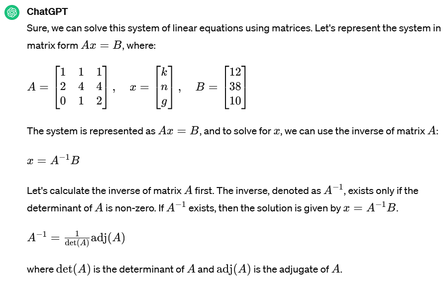

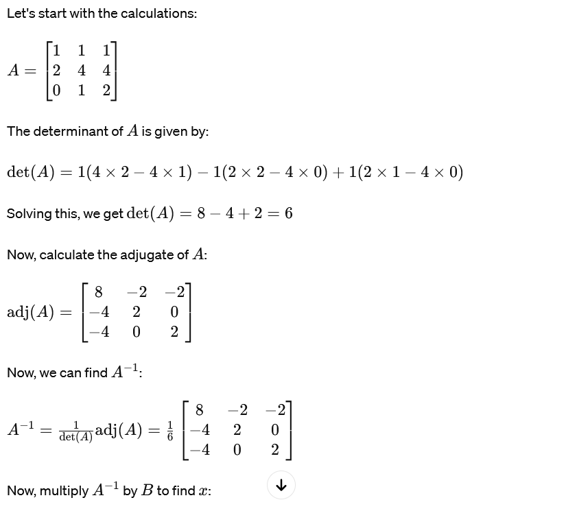

---

<!-- _class: interest-slide -->

## Ter info: dit is wat chatGPT ervan bakte

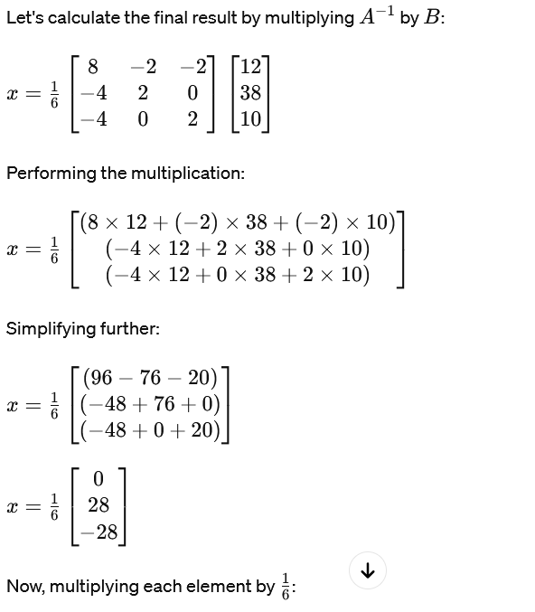

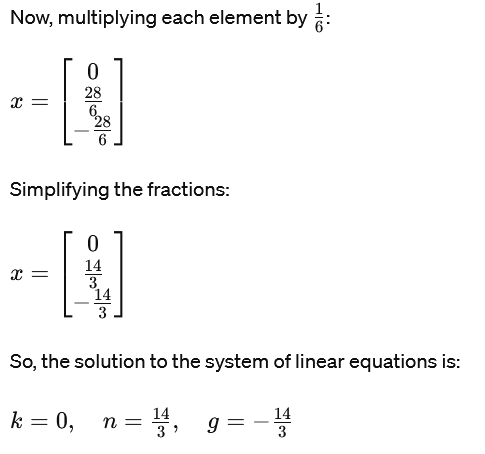

---

<!-- _class: interest-slide -->

## Bij een tweede poging, nog steeds fout

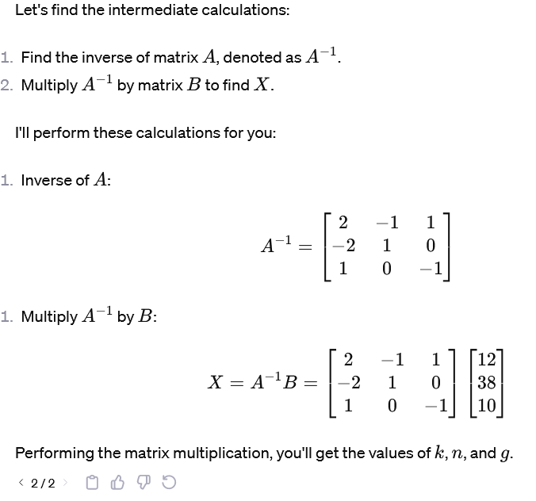

Hierna ben ik gestopt en overgestapt op een klassieke rekenmachine

---

## Voorbeeldprobleem - randvoorwaarden

- We voegen een randvoorwaarde toe: minstens 5 hoorns in totaal
- De rest van de voorwaarden blijft exact geldig

| voorwaarde | vorm |
|---|---|
| 12 hoofden | $k + n + g = 12$ |
| 38 voeten | $2k + 4n + 4g = 38$ |
| minstens 5 hoorns | $n + 2g \geq 5$ |

---

## Voorbeeldprobleem - ongelijkheden

- Elke gelijkheid splitsen we in twee ongelijkheden
- Voorbeeld: $k + n + g = 12$ wordt $12 \leq k + n + g \leq 12$
- Zonder bovengrens gebruiken we $+\infty$

$$5 \leq n + 2g \leq +\infty$$

---

## Voorbeeldprobleem - grenzen in matrixvorm

$$l \leq Ax \leq u, \qquad A = \begin{pmatrix} 1&1&1\\ 2&4&4\\ 0&1&2 \end{pmatrix}$$

| grens | l | u |
|---|---|---|
| hoofden | 12 | 12 |
| voeten | 38 | 38 |
| hoorns | 5 | $+\infty$ |

- Elke (in)gelijking wordt een rij in A
- Zo'n systeem heeft vaak meerdere oplossingen

---

## Voorbeeldprobleem - kostfunctie

- Bij meerdere oplossingen kiezen we de beste via een kostfunctie
- Voorbeeld: minimaliseer $\frac{1}{2}(k^2 + 50n^2 + 2g^2) + g$
- Dit is van de vorm $\frac{1}{2}x^TPx + q^Tx$:

$$P = \begin{pmatrix} 1&0&0\\ 0&50&0\\ 0&0&2 \end{pmatrix}, \qquad q = \begin{pmatrix} 0\\ 0\\ 1 \end{pmatrix}$$

---

## Voorbeeldprobleem - visueel

- Randvoorwaarden zijn snijdende vlakken in de zoekruimte
- De kostfunctie duidt één punt aan als allerbeste oplossing

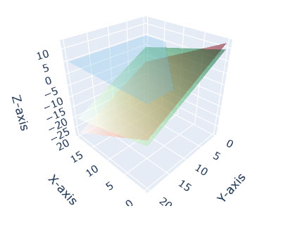

---

## Algemeen probleem

- Variabelen: de waarden die we willen weten
- Minimalisatie: een kostfunctie minimaliseren
- Constraints: gelijkheden of ongelijkheden
- Algemene vorm:

$$\min_x \frac{1}{2}x^TPx + q^Tx \qquad \text{met } l \leq Ax \leq u$$

- P en q liggen vast door het probleem en bepalen de kostfunctie
- l en u zijn de onder- en bovengrenzen van de constraints

---

## Library gebruiken - OSQP

- OSQP lost kwadratische optimalisatieproblemen op
- Jij bouwt de matrices P, q, A, l en u op, dat is het moeilijkste deel
- Documentatie: https://osqp.org/docs/get_started/python.html
- [DEMO] De matrices opzetten wordt geoefend in het oefenlabo

---

## Kostfuncties: drie soorten

De juiste kost hangt af van de vraag in de opgave:

| vraag | kostfunctie | P | q |
|---|---|---|---|
| winst maken | $\min -\text{winst}(x)$ | $0$ | $-\text{winst}$ |
| zo dicht mogelijk | $\min \frac{1}{2}\|Ax-b\|^2$ | $A^TA$ | $-A^Tb$ |
| gewogen dichtstbij | $\min \frac{1}{2}\|Ax-b\|_W^2$ | $A^TWA$ | $-A^TWb$ |

---

## Kostfunctie 1: winst maken

Een bedrijf maakt twee producten met grondstoffen X en Y:

| product | X per stuk | Y per stuk | winst |
|---|---|---|---|
| AquaSparkle (a) | 2 | 1 | €5 |
| BioBurst (b) | 1 | 3 | €8 |

- Voorraad: 100 X en 90 Y
- Winst maximaliseren = kost minimaliseren, dus $\min -(5a + 8b)$

---

## Kostfunctie 1: matrixvorm

$$q = \begin{pmatrix} -5\\ -8 \end{pmatrix}, \qquad P = \begin{pmatrix} 0&0\\ 0&0 \end{pmatrix}$$

Constraints als $l \leq Ax \leq u$:

- $2a + b \leq 100$ (grondstof X)
- $a + 3b \leq 90$ (grondstof Y)
- $a \geq 0$ en $b \geq 0$

$$A = \begin{pmatrix} 2&1\\ 1&3\\ 1&0\\ 0&1 \end{pmatrix}, \quad l = \begin{pmatrix} -\infty\\ -\infty\\ 0\\ 0 \end{pmatrix}, \quad u = \begin{pmatrix} 100\\ 90\\ +\infty\\ +\infty \end{pmatrix}$$

---

## Kostfunctie 1: oplossing

- OSQP vindt het optimale productiemengsel
- a = 42 en b = 16
- Winst: $5 \cdot 42 + 8 \cdot 16 = 338$ euro
- P = 0, de kost is lineair, enkel de q-term telt

---

## Kostfunctie 2: zo dicht mogelijk

- Een exacte oplossing bestaat niet altijd (conflicten, ruis of meer metingen dan variabelen)
- We zoeken dan de oplossing die het dichtst bij alle voorwaarden ligt
- Dat is de kwadratische (euclidische) afstand tussen $Ax$ en $b$:

$$\min_x \|Ax-b\|^2 = \min_x (Ax-b)^T(Ax-b)$$

---

## Kostfunctie 2: uitwerken

$$(Ax-b)^T(Ax-b) = x^TA^TAx - 2b^TAx + b^Tb$$

- De constante $b^Tb$ verandert het optimum niet
- Min $\|Ax-b\|^2$ heeft hetzelfde optimum als min $\frac{1}{2}\|Ax-b\|^2$:

$$\frac{1}{2}x^T(A^TA)x - (A^Tb)^Tx = \frac{1}{2}x^TPx + q^Tx$$

$$\boxed{P = A^TA \qquad \text{en} \qquad q = -A^Tb}$$

---

## Kostfunctie 2: rekenvoorbeeld

De boerderij, maar de hoornmeting klopt niet meer: $b = (12, 38, 6)$

$$P = A^TA = \begin{pmatrix} 5&9&9\\ 9&18&19\\ 9&19&21 \end{pmatrix}$$

$$q = -A^Tb = \begin{pmatrix} -88\\ -170\\ -176 \end{pmatrix}$$

- P en q invullen in OSQP geeft de beste benadering van alle voorwaarden

---

## Kostfunctie 2: gewogen versie

- Elke constraint heeft zijn eigen nauwkeurigheid
- Gewichten zetten we in een diagonaalmatrix W:

$$P = A^TWA, \qquad q = -A^TWb$$

- Betrouwbare meting: hoog gewicht, onbetrouwbare meting: laag gewicht (relaxatie)
- In het labo: min $w^T\Sigma w$ bij de portefeuille, ook een kwadratische kost

---

## Variabelen en constraints bepalen

Stappenplan:

1. Variabelen: wat wil je weten? elk getal wordt een kolom in x, bv. k, n en g
2. Constraints: elke voorwaarde wordt een rij in A met $l \leq Ax \leq u$
3. Kostfunctie: winst wordt $-\text{winst}$ (q), dichtstbij wordt $A^TA$ (P)
4. Controle: aantal kolommen van A = aantal variabelen, aantal rijen = aantal voorwaarden

> Kippen: 3 variabelen en 3 voorwaarden, fabriek: 2 variabelen en 4 voorwaarden

---

## Van opgave naar matrices

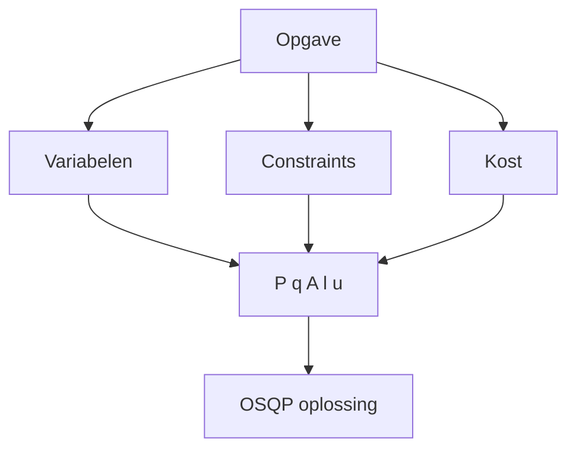

---

<!-- _class: interest-slide -->

## AI & verkeerskunde

Een concreet voorbeeld van linear programming in de praktijk

---

<!-- _class: interest-slide -->

## Macroscopisch verkeersmodel

Macroscopische modellen bekijken we vanuit drie invalshoeken:

| microscopisch | nieuwe technieken | verkeerskunde |
|---|---|---|
|  |  |  |

---

<!-- _class: interest-slide -->

## Klassiek verkeerskunde model

- Voorspellingen op basis van geografische input, zoals woonwijken en kantoorwijken
- Een exacte kaart van de hoofdwegen
- Lokale metingen via meetlussen

---

<!-- _class: interest-slide -->

## Klassiek verkeerskunde model - meetlussen

- Meetlussen: magnetische strips in de grond
- AI-oplossing: camerabeelden met beeldherkenning, https://www.verkeerscentrum.be/camerabeelden
- De meetlussen dienen als lokale ijkingspunten van de statische verkeersmodellen

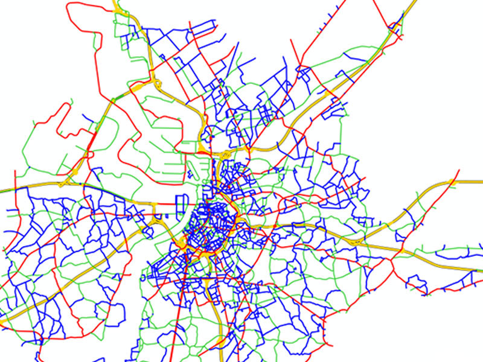

---

<!-- _class: interest-slide -->

## AI in macroscopische modellen

- Beeldherkenning op vaste camera's
- ANPR-beeldherkenning
- Mogelijke uitbreiding: rekeningrijden, maar er zijn privacybezwaren

---

<!-- _class: interest-slide -->

## AI in macroscopische modellen: YOLO

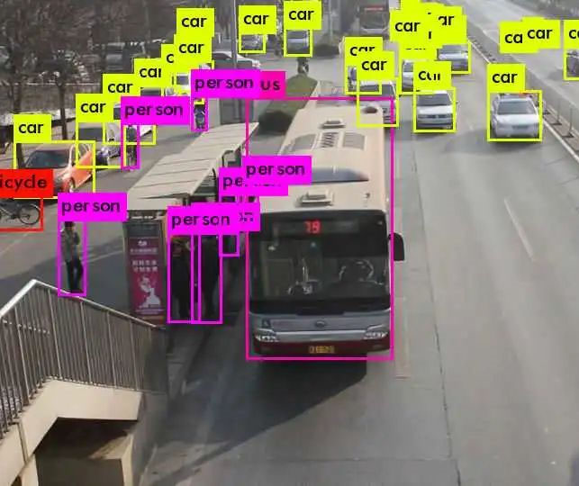

- You Only Look Once
- Deep learning, razendsnel

---

<!-- _class: red-bg interest-slide -->

# Microscopische verkeersmodellen

---

<!-- _class: interest-slide -->

## Microscopisch: 1 kruispunt of 1 straat

- Vroeger: statistische tabellen

| richting | aandeel |
|---|---|
| links | 25% |
| rechtdoor | 50% |
| rechts | 25% |

- Nu via Telraam: open data, een data-driven tool voor lokaal beleid
- Nog andere technieken: bluetooth scanners en crowdscanners met lasers

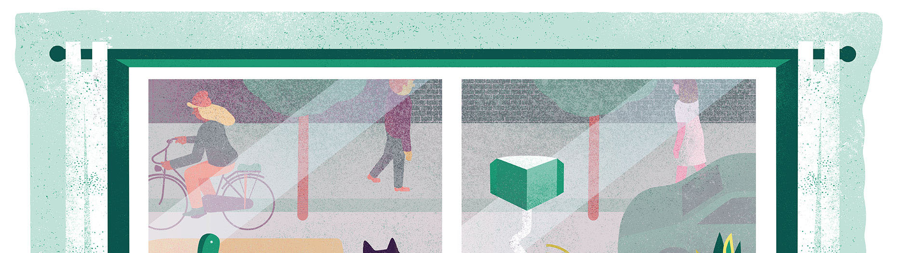

---

<!-- _class: interest-slide -->

## Hoe werkt telraam?

- Stap 1: tweewielers versus vierwielers, simpele clustering op 2 dimensies
- Kenmerken: length-width ratio en fullness
- Stap 2: auto's versus grote voertuigen, na calibratie van de lengte

| 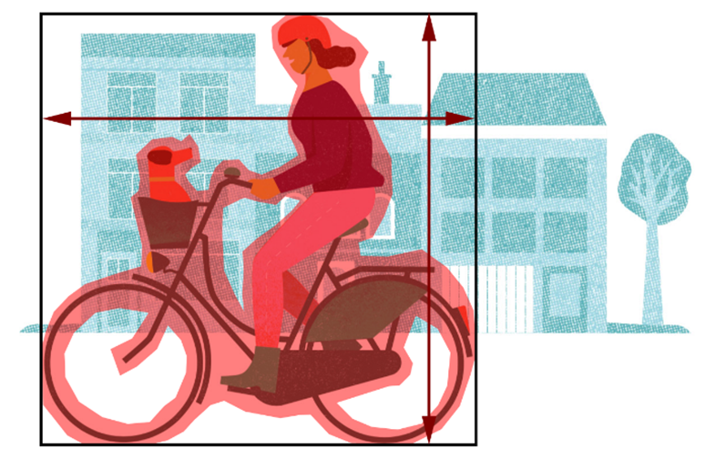 | 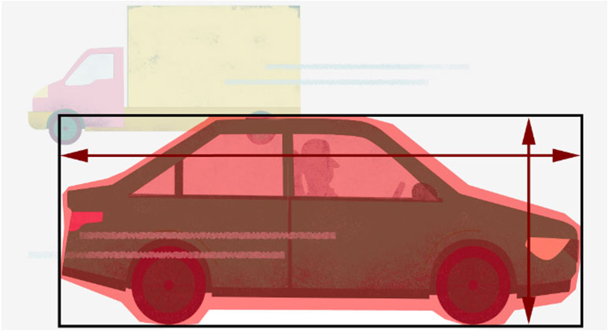 |
|---|---|
| 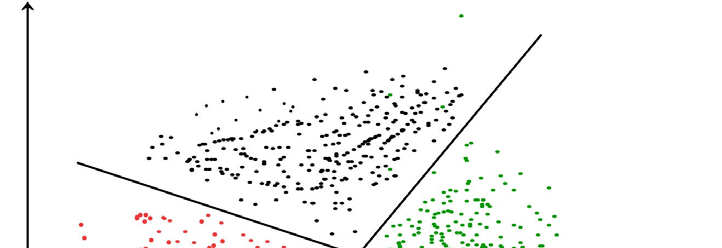 | 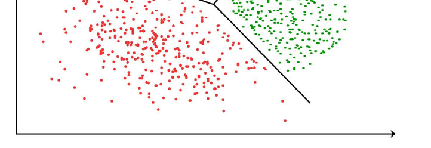 |

---

<!-- _class: red-bg interest-slide -->

# Nieuwe technieken

---

<!-- _class: interest-slide -->

## Data Fusion

- Combinatie van telco, FCD (GPS-data van auto's), telraam, ANPR, velo en parkingdata
- Doel: een overkoepelend beeld van het verkeer

|  | 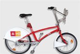 |  |

---

<!-- _class: interest-slide -->

## Data Fusion - combinatie

- Telco, FCD, telraam, ANPR, velo en parkingdata combineren
- Hoe doe je dat? Via een optimalisatiemodel

|  |  |  |

---

<!-- _class: interest-slide -->

## Data Fusion = kinderspel, knikkerspel

- Elke databron legt restricties op over bepaalde soorten verkeer
- De datalocaties kunnen overlappen
- Nauwkeurigere bronnen krijgen een hogere relaxatieparameter
- De knikkers liggen zodanig op de stratengrid dat ze aan zoveel mogelijk criteria voldoen
- Technisch: linear optimization model met een kwadratische kostfunctie

---

## Samenvatting

- Continue problemen lossen we op als kwadratische optimalisatie
- Algemene vorm: min $\frac{1}{2}x^TPx + q^Tx$ met $l \leq Ax \leq u$
- Kostfunctie winst: $q = -\text{winst}$ en $P = 0$, kostfunctie dichtstbij: $P = A^TA$ en $q = -A^Tb$
- Stappenplan: variabelen, constraints, kostfunctie en controle
- OSQP lost op, jij bouwt de matrices
- Data fusion in de verkeerskunde is zo'n optimalisatiemodel

---

<!-- _class: red-bg -->

# Vragen?

